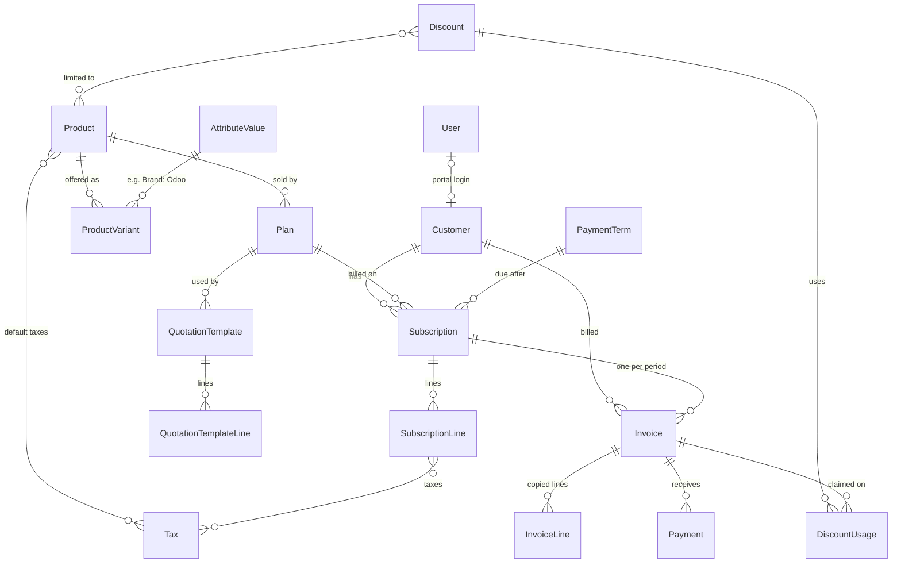

# Subman

Brightloop's subscription management system. It covers products and plans, quotations, the subscription lifecycle, recurring invoices with taxes and automatic discounts, payments and receivables, a finance dashboard and a customer portal.

Built solo with Claude Code in an ~8-hour hackathon.

## Quick start

Needs Node 24+ and a local PostgreSQL.

```sh
# 1. Database (Arch Linux shown; adapt for your OS)
sudo -iu postgres psql -c "CREATE ROLE subman LOGIN CREATEDB PASSWORD 'subman';"
sudo -iu postgres createdb -O subman subman

# 2. App
cp .env.example .env            # set BETTER_AUTH_SECRET: openssl rand -base64 32
npm install                     # also generates the Prisma client
npx prisma migrate deploy
npm run seed                    # catalog, demo logins, a few subscriptions
npm run seed:bulk               # ~3k customers, ~10k subscriptions, a year of invoices and payments

# 3. Run in production mode (as in the demo)
npm run build && npm start      # http://localhost:3000
```

To start over, `npm run demo:reset` resets the database, applies the migrations and runs both seeds.

### Demo logins

The password for all three is `Demo@12345`.

| Role | Email | Lands in |
|---|---|---|
| Admin | admin@brightloop.test | Back office, plus Users and Outbox |
| Staff | staff@brightloop.test | Back office (catalog is read-only) |
| Customer | customer@brightloop.test | Customer portal |

Without SMTP configured, every email (password resets, quotations, invoices, reminders) lands in **Admin › Outbox**. With SMTP set in `.env`, it is also sent.

### Scripts

| Script | What it does |
|---|---|
| `npm run dev` | Dev server |
| `npm run build` / `npm start` | Production build / server |
| `npm run typecheck` | Route types + `tsc` |
| `npm test` | Vitest: money, dates, periods, taxes, discounts, lifecycle rules, schemas |
| `npm run seed` / `npm run seed:bulk` | Demo data / bulk data (both safe to re-run) |
| `npm run perf` | Times every main page of a running build (see [Performance](#performance)) |
| `npm run demo:reset` | Reset the DB, then the demo and bulk seeds |

## Features

| Area | What you can do |
|---|---|
| **Auth & roles** | Sign up (creates the customer record), log in, forgot / reset password with a 1-hour single-use link. Passwords need 9+ characters with upper, lower and special. One account per email. The admin adds staff, who set their own password from an emailed link. Every page and server action checks the role on the server. |
| **Catalog** | Products (service/goods, sales and cost price, default taxes), attributes and variants with an extra price (Brand: Odoo +560), plans (price per daily/weekly/monthly/yearly × interval, minimum quantity, available dates, auto-close / closable / pausable / renewable), taxes (percentage or fixed per unit), payment terms, and quotation templates. The admin edits the catalog; staff see it read-only. |
| **Subscriptions** | Create one blank or from a template. Pick the customer, a plan (only plans available on the start date are offered), start and expiry dates and payment terms, then edit lines with live untaxed / tax / total figures. The lifecycle is Draft → Quotation → Confirmed → Active → Closed, plus Paused. A status bar and an activity timeline show who did what and when. Sending a quotation emails the customer. Add-ons can be switched on or off while a subscription runs, taking effect from the next invoice. |
| **Billing run** | "Run billing" for any date activates confirmed subscriptions that have started, drafts an invoice for every due period (catching up missed ones) and closes expired auto-close subscriptions. Each run's summary is kept as history. Admins can also bill one subscription up to a date. |
| **Invoices** | Created from the subscription with a customer snapshot, lines, discounts, taxes and totals. Draft → Confirmed (numbered INV/2026/00001 on confirm) → Paid. Also cancel, send by email, print / save as PDF, and confirm drafts in bulk. |
| **Discounts** | Admin-only rules: fixed or percentage, minimum purchase or quantity, start and end dates, a usage limit, and scope (selected products or the whole subscription). They apply **automatically** when an invoice is built and stop once expired or used up. |
| **Payments & receivables** | Register payments (UPI, bank transfer, card, cash, cheque) against confirmed invoices. Part payments are fine; the invoice turns Paid when nothing is due. Outstanding and Overdue tabs, days overdue, 0–30 / 31–60 / 61–90 / 90+ aging, and overdue reminders. |
| **Dashboard** | Active subscriptions, MRR / ARR, collected, invoiced, outstanding and overdue, plus invoiced vs collected per month, subscriptions by plan and status, and the largest overdue invoices. Filters (date range, plan, status) live in the URL, and every number links to the list behind it. |
| **Customer portal** | Customers see only their own subscriptions and invoices; anyone else's id returns 404. Where the plan allows, they can pause, resume, renew or close, and they can print invoices and see their payment history. |

## Architecture

- **Next.js 16** App Router with Server Components for every page and Server Actions for every write. Lists page, sort and filter in SQL from URL params.
- **PostgreSQL + Prisma 7** using the `pg` driver adapter. CHECK constraints sit in a raw SQL migration.
- **Better Auth** handles email and password auth with database sessions and built-in rate limiting. Its hooks re-check the password policy, so the API can't be called around the forms.
- **Zod** schemas are shared by the forms (react-hook-form) and the server actions, so validation can't drift between them.
- **Tailwind + shadcn/ui** for the UI, with Recharts behind the dashboard charts.

Key modules:

| Module | Role |
|---|---|
| `src/lib/subscriptions/transitions.ts` | The lifecycle as one table, plus pure rules for what each actor (staff, customer, system) may do now, and why not. The UI shows only the actions on offer. |
| `src/lib/subscriptions/service.ts` | The only code that changes a subscription's status. It locks the row, re-checks the rules and writes the change and its timeline entry in one transaction. Staff screens, the portal and the billing run all call it. |
| `src/lib/billing/totals.ts` | Line and document totals. The line editor and invoices both use it, so they never disagree. |
| `src/lib/billing/invoice.ts` | Billing periods (month-end clamping) and `buildInvoice()`: automatic discounts, proportional split, taxes. All pure functions. |
| `src/lib/billing/run.ts` | `billSubscription()` and `runBilling()` |
| `src/lib/billing/invoices.ts` | Confirm, cancel, send, reminders and payments |

### Data model



Also: `Sequence` (gap-free numbers), `ActivityLog` (timelines), `EmailLog` (Outbox), `BillingRun` (run history).

## Key decisions

- **Money** is stored in integer minor units and percentages in basis points (18% = 1800). There are no floats anywhere, and tax is rounded half-up per line.
- **A plan sells one product.** The plan's line is priced at the plan price plus any variant extra and must meet the plan's minimum quantity. Other lines use their product's sales price.
- **Billing in advance:** each invoice covers the one period that starts on its invoice date, and is due after the payment-term days. Periods count from the start date; a start on the 31st gives Jan 31 → Feb 28 → Mar 31.
- **No proration.** Line changes apply from the next invoice. Pausing stops billing, and resuming restarts the cycle from the resume date. Renewing extends the expiry by the original term.
- **Plan flags apply to everyone**, staff included. A subscription past its expiry can always be closed.
- **Invoices start as drafts.** Numbers are assigned on confirm inside the confirming transaction, so there are no gaps.
- **Discounts are automatic and don't stack.** A line gets at most one product rule and an invoice at most one subscription rule, whichever saves more. A subscription discount is split across lines in proportion, so tax is charged on the discounted amounts. A use is claimed with a guarded update (`usedCount < usageLimit`), so two invoices can't take the last use. Cancelling an invoice gives its uses back.
- **Payments** must be more than 0 and no more than the amount due. The invoice turns Paid automatically. Overdue means Confirmed, past due, with an amount still due.
- **Dates** are date-only columns, and "today" is taken in one business timezone (`APP_TZ`).
- **Nothing that is referenced gets deleted.** Products, plans, taxes and rules are switched off instead.

### Never billed twice, never skipped

- **Never twice:** a unique index on `Invoice (subscriptionId, periodStart)` rejects a duplicate even if the code has a bug. Each subscription is billed in its own transaction under a `SELECT … FOR UPDATE` row lock, so overlapping runs wait on each other. Running billing again for the same date creates 0 invoices.
- **Never skipped:** billing loops while the next invoice date is on or before the run date, so a missed day is caught up period by period.
- **One failure doesn't stop the run:** a subscription that fails is recorded on the run and the run moves on.

## Performance

The requirement is every page under 2 s with thousands of subscriptions; the aim is under 500 ms. These are measured on the production build with the bulk seed loaded:

```sh
npm run build && PORT=3100 BETTER_AUTH_URL=http://localhost:3100 npx next start -p 3100
BASE_URL=http://localhost:3100 npm run perf
```

Measured 2026-10-31 on a laptop with 3,001 customers, 10,001 subscriptions, 52,760 invoices and 44,460 payments:

| Page | Warm time |
|---|---|
| Dashboard (12 months, all KPIs and charts) | 362 ms |
| Dashboard, custom date range | 344 ms |
| Subscriptions list (all / Active tab / search) | 81–87 ms |
| Subscription detail | 100 ms |
| New subscription (form with every picker) | 155 ms |
| Customers list / search / detail | 51–64 ms |
| Invoices list / Overdue tab / detail | 49–91 ms |
| Payments, billing runs, catalog | 44–68 ms |
| Print invoice | 34 ms |
| Customer portal pages | 26–42 ms |

Slowest page 362 ms, average 90 ms over 22 pages. Billing day for 1 Nov drafts 267 invoices (and activates 9 subscriptions) in 6.5 s; running it again for the same date creates 0 in 0.3 s.

Every dashboard total is computed in SQL (`GROUP BY` / aggregates), never by loading rows into JavaScript, and the list pages use the indexes on status, customer, next invoice date, due date and invoice date.
